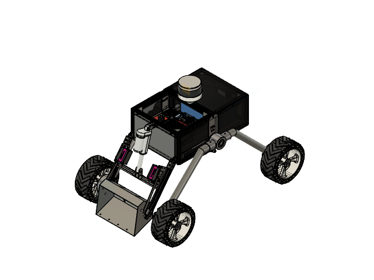
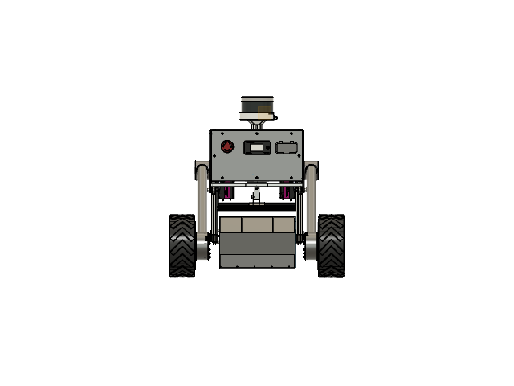

# Rover Mechanical CAD Design

## 1. Project Overview

This project documents the mechanical CAD design of a mobile robotic rover platform. It focuses on the structural arrangement, chassis layout, wheel configuration, and integration of mechanical components.

The CAD assembly provides a visual representation of the rover's overall mechanical architecture.

## 2. Design Features

- Rover chassis and structural layout
- Wheel arrangement and mobility configuration
- Mechanical component integration
- CAD assembly modelling and visualisation
- Design considerations for fabrication and prototyping

## CAD Model Views

### Isometric View

### Front View

### Rear View

### Left View

### Bottom View

## 4. Software Used

- [Specify the CAD software used for this model]

## 5. Engineering Scope

The project focuses on mechanical design, component arrangement, chassis layout, and assembly visualisation.

Structural analysis, load capacity, mobility performance, and other validation results are documented only where supported by separate calculations or testing.

## 6. Documentation

This directory contains selected CAD visualisations of the rover assembly.

Additional engineering drawings, component details, and technical specifications may be included as they become available.

